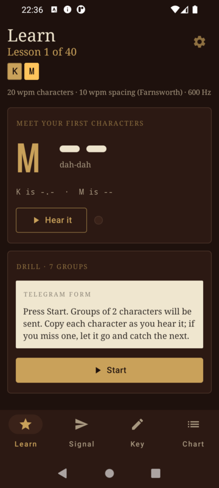
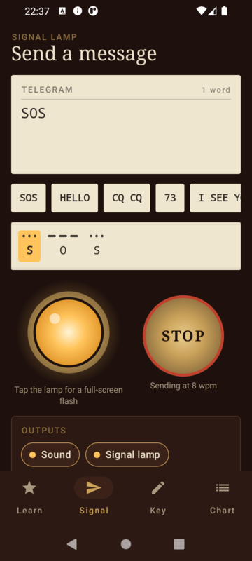
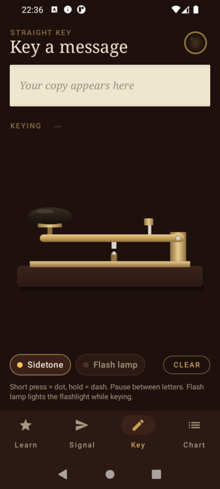
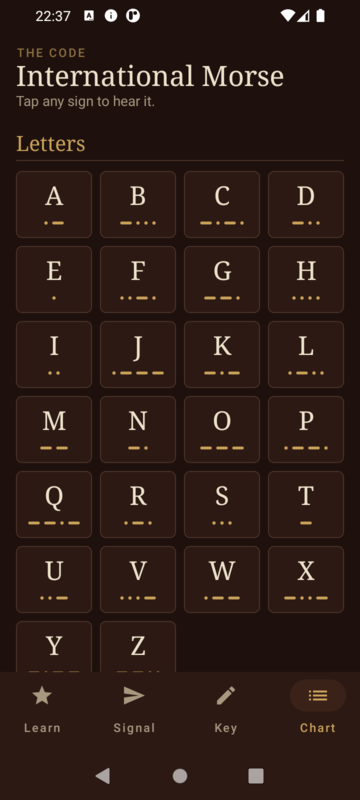

<h1 align="center">Telegraph</h1>
<p align="center"><b>Learn Morse code, then use it: by sound, flashlight or vibration.</b></p>

An Android app for learning and sending Morse code, styled like a telegraph office at night: mahogany, brass, paper ticker tape and an amber signal lamp.

| Learn | Signal lamp | Straight key | Chart |
|---|---|---|---|
|  |  |  |  |

## Features

- **Learn with the Koch method**, the way radio operators train. You hear characters at full speed (20 wpm) from day one, with extra space between them (Farnsworth timing), starting with just **K** and **M**. Copy at 90% or better and the next character unlocks. There are 40 lessons, covering the alphabet, numbers and punctuation.
- **Signal**: type a message and send it as **sound**, with your **flashlight** as a signal lamp, or as **vibration**. The ticker tape lights each character as it goes. *Repeat* turns it into a beacon. A full-screen lamp flash works for signalling at night, even on phones without a torch.
- **Straight key**: tap a brass telegraph key and watch your sending decoded live. The decoder adapts to your speed, and the flashlight can light while you key.
- **Chart**: every letter, figure, punctuation mark and prosign (SOS, AR, SK…). Tap any of them to hear it.

Correct timing everywhere: dot = 1 unit, dash = 3, gaps of 1 / 3 / 7, at PARIS-standard speeds. Tones have soft 5 ms edges, so they don't click.

## Install

Download the APK from [Releases](../../releases) and sideload it. It needs Android 8.0 or newer.

It uses no internet, no trackers and no Play Services. The only permission is vibration; the flashlight doesn't need a permission.

## Build

```sh
./gradlew assembleDebug
```

Kotlin and Jetpack Compose. The Morse engine (`morse/`) is plain Kotlin with unit tests.

## Licence

GPL-3.0 (see [LICENSE](LICENSE)). The Koch character order follows LCWO.
